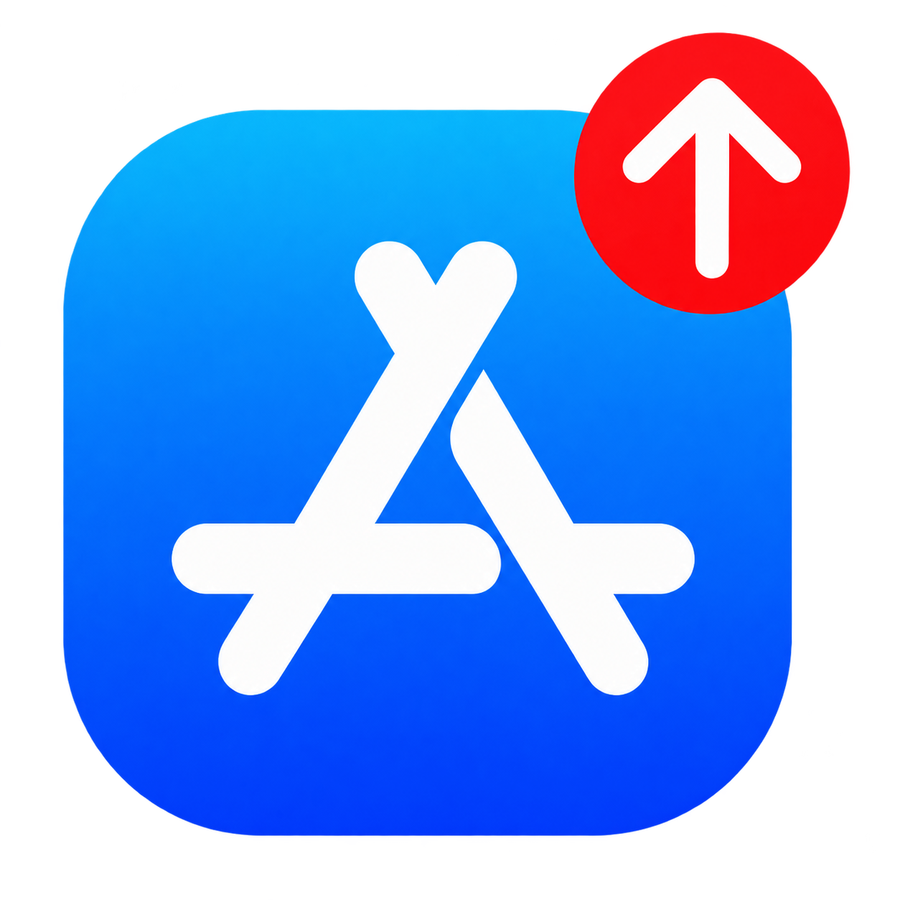

# App Store Updates Page

App Store Updates Page opens the **Account / Updates Page** and quietly refreshes available updates every time App Store comes to the foreground, including after a cold launch. If the **Account / Updates Page** is already visible, it refreshes in place.

Tested on iOS 16.6 and 26.0.1. The packages target iOS 15 and later.

Download the matching package from [Releases](https://github.com/sahinkaa/AppStoreUpdatesPage/releases/tag/v1.0).

- **Standard rootless** uses the `iphoneos-arm64` package.
- **RootHide** uses the `iphoneos-arm64e` package.
